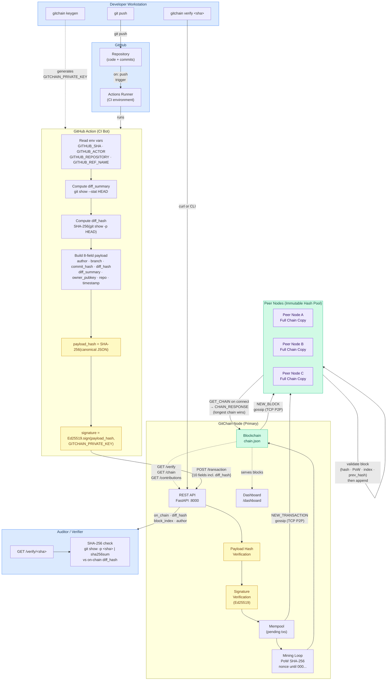

## GitChain System Block Diagram

There are five stakeholders in the GitChain system.

1. **Developer** writes code and runs `git push`, triggering the entire pipeline.
2. **GitHub** hosts the repository and fires the GitHub Actions workflow on every push.
3. **GitHub Action (CI Bot)** computes the diff hash, builds + signs the transaction payload with Ed25519, and POSTs it to the GitChain node.
4. **GitChain Node** validates the signature, stores the transaction in the mempool, mines it into a block, persists to `chain.json`, and serves the REST API + Dashboard.
5. **Peer Nodes** receive new blocks and transactions via P2P gossip, independently validate each block, and maintain their own full chain copy — ensuring no single node can rewrite history.

### Key Data Flows

| Flow | What travels | Purpose |
|---|---|---|
| Developer → GitHub | `git push` | Triggers the pipeline |
| GitHub → Action | Env vars (SHA, actor, repo) | Provides commit identity |
| Action → Node | Signed 10-field transaction | Records commit on-chain |
| Node → Peers | `NEW_BLOCK` / `NEW_TRANSACTION` (TCP) | Decentralized replication |
| Peers → Node | `CHAIN_RESPONSE` on connect | Syncs to longest valid chain |
| Auditor → Node | `GET /verify/<sha>` | Returns `diff_hash` + `author` for proof |
| Auditor → Git | `git show -p <sha>` | Reproduce diff; compare SHA-256 to `diff_hash` |
